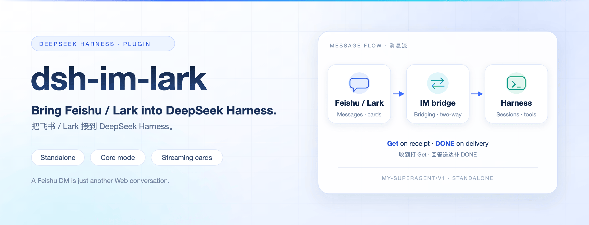

# dsh-im-lark

[简体中文](README.md) · **English**



Connect a Feishu / Lark bot to DeepSeek Harness: DM the bot in Feishu and it is the same as chatting in the Web UI.

Two independent modes:

| Mode | Switch | Needs the core | Behaviour |
| --- | --- | --- | --- |
| **Standalone** (default) | Connect Feishu, turn off "Use my super agent" | No | The plugin creates its own session and you chat in Feishu directly; text commands, question and approval reminders are handled by the plugin |
| **Core** | Connect Feishu + Use my super agent | Yes | Feishu becomes another entry point to the Web UI: messages, commands and reminders all go to the core |

The two modes are mutually exclusive: the core is used only when "Use my super agent" is on and the core service is running; otherwise everything stays standalone, so a message is never handled twice. The core switch on the panel is disabled when the core is not installed.

## Features

- **Inbound**: text, rich text, images, files; voice, video and stickers get an explicit notice instead of being dropped silently
- **Outbound**: Markdown cards and images; long answers are split by both character count and card size limits
- **Quoted replies**: answers quote the message that triggered them, in DMs and groups alike
- **Processing feedback**: an incoming message gets a `Get` reaction first; `DONE` is added to the original message only after the answer is actually delivered, and the two stay side by side. Being queued is not completion (the core queues the message and runs the task asynchronously). In core mode the plugin follows the core's `completes` markers (stall notices, dispatch receipts and transfer confirmations never carry them; cancelled, failed, approval-rejected or token-limit-truncated rounds do not carry them either, because they have no normal answer; older cores do not send them at all). Standalone mode aligns reactions per turn, and reminder answers are marked at settlement time (when only some questions are answered the reminder is still waiting, so no `DONE`). On failure only `Get` remains — never a false "done". Each message is marked once. Feishu has no official "typing" API
- **Card updates**: streaming answers update the same card in place; after platform limits (14 days, 5 QPS per card) a new card is sent
- **Interactive cards**: in core mode, **single-question** single- and multi-select questions are answered in Feishu and the result is returned to the core; in standalone mode single questions are also sent as cards (single and multi select are both checkboxes, distinguished by copy, and must be submitted), everything else stays a text reminder. Multi-question and approval prompts are notice-only and must be answered in the Web UI (the core requires all questions in one submission, which card callbacks cannot do per question); both support an "other" input
- **Groups**: only messages that @mention the bot are handled (only the @-scoped group permissions are requested); the whole group is never read
- **Task reminders**: in standalone mode, a long turn (30 minutes by default) sends a reminder with elapsed time and conclusion when it ends; a failed or externally aborted turn is reported immediately with the original error. A stop pressed by the owner is not a failure
- **Panel**: create an app with one scan on the Web plugin page, or enter App ID / App Secret manually; see connection state, toggle send/receive and core mode, change message behaviour; in standalone mode, adjust in-turn steering, session workspace, question/approval reminders and long-task reminders

> Question cards (checkboxes + submit + "other" input) have been verified in a real Feishu tenant in both standalone and core mode: single and multi select are distinguished by card copy, and a submission returns the checked options plus the "other" input. Rejected answers give visible feedback in both modes: a card that can still be answered is **re-rendered whole** with the reason (Feishu form submissions are one-shot; a text-only hint would leave the card unclickable) so you can re-select and submit; a card that can no longer be answered becomes invalid and loses its checkboxes. `Get` / `DONE` reactions and card layout vary slightly with tenant settings; what you see is what the platform does.

## Install

Stable releases go to `latest`, prereleases to channel tags (`stage` / `rc`); they never overwrite each other:

```bash
# stable
dsh plugin --profile web add dsh-im-lark

# prerelease
dsh plugin --profile web add dsh-im-lark@stage
```

From source (development):

```bash
npm install
npm run build
dsh plugin --profile web add file:/absolute/path/dsh-im-lark
```

A `file:` dependency is an **injected copy**: once installed into the profile's `node_modules` it is decoupled from the repo. After changing code run `npm run build`, then remove and re-add to sync the running host.

```bash
dsh plugin --profile web remove dsh-im-lark
dsh plugin --profile web add file:/absolute/path/dsh-im-lark
```

No need to restart `dsh web` after reinstalling: the host half is hot-reloaded, so just refresh the browser. Open **Settings → Lark Bot** (or **Plugins → dsh-im-lark**) to enter credentials.

### Create an app by QR code

On the panel, under "App credentials", click "Create app by QR code", scan the QR code with Feishu and confirm on your phone. Credentials are saved and the connection starts automatically; the QR code is valid for 1 hour and can be used by one user only.

The created app still needs its permissions and event subscriptions confirmed (next section). If the long connection never receives messages, first check that "Event subscriptions" uses the **long connection** mode and that `im.message.receive_v1` is subscribed.

## Feishu setup

1. Create an **enterprise self-built app** on the [Feishu Open Platform](https://open.feishu.cn/app) and copy its App ID and App Secret.
2. **Add app capability → Bot**.
3. Under **Permissions**, enable:
   - `im:message.p2p_msg:readonly` (receive DM messages)
   - `im:message.group_at_msg:readonly` (receive group messages that @mention the bot)
   - `im:message:send_as_bot` (send messages as the bot)
   - `im:resource` (upload/download images and files)
   - Reaction permissions (optional): the reaction-related scopes in the console. Missing them does not break the main flow; the "processing" hint degrades to not being sent
4. **Events & callbacks**:
   - "Event subscriptions": choose the **long connection** mode and subscribe to `im.message.receive_v1`;
   - "Callback configuration": add `card.action.trigger` (needed for card interactions), also over the long connection
5. **Publish a version** and wait for admin approval; before publishing only the developer can use it.

> Long-connection mode needs no public URL and no request URL. Each app allows up to 50 long connections; with multiple instances **only one** connection receives events, so do not scale horizontally by running several processes.

## Configuration

Static config lives in the profile patch; restart to apply:

```yaml
- id: dsh-im-lark
  name: dsh-im-lark
  config:
    domain: feishu          # feishu (default) or lark (international)
    maxText: 2000           # max characters per message; longer text is split automatically
    typingIndicator: true   # Get on receipt; DONE on the original message after delivery (Get is never removed)
    replyStatus: false      # append model, elapsed time and tokens to the answer
    directBusyMode: steer   # a message arriving mid-turn in standalone mode: steer / queue (legacy interrupt migrates to steer)
    directWorkspaceId: ''   # workspace id for standalone sessions; empty uses the auto-created default
    questionReminders: true # standalone: send a Feishu reminder when a question or approval is waiting
    questionDelayMinutes: 5 # how long to wait before reminding (0–120): answering in the Web UI within this window avoids it
    longTaskReminders: true # standalone: send a completion reminder when a turn exceeds the threshold
    longTaskMinutes: 30     # long-task threshold (1–1440 minutes)
    failureReminders: true  # standalone: report a failed or externally aborted turn immediately
```

Items editable in the panel are written to `$DSH_HOME/.dsh-im-lark/config.json` and survive a reinstall. Credentials live in `credentials.json` (directory 0700, file 0600); logs and errors only ever show the last six characters of the App ID. The panel shows the full App ID and binding time; the Secret is never echoed.

## Standalone commands

| Command | Effect |
| --- | --- |
| `/help` | List commands |
| `/new` | Start a new session |
| `/sessions [page]` | List recent sessions and their numbers (excluding the front session), 10 per page |
| `/switch <index, 0, front, or session id>` | Switch the current session; `0` and `front` return to the front session |
| `/status` | Current session and runtime state |
| `/stop` | Abort the running turn |
| `/trace` | Model and elapsed time of the last answer |
| `/send <index, 0, or session id> <text>` | Send to that session; its answer comes back here. `0` is the front session. Images allowed |

`/send` is queued, so it does not interrupt the target session's running turn; sending to the current session behaves like a normal message. A `/switch` binding and its prefix survive restarts and are cleared by `/new`; after switching to a non-front session, replies are prefixed with `**session name>**`, and returning to the front session (index `0`) drops it. The front session is always index `0` and is omitted from `/sessions`, so returning to it does not produce a self-referential list. Switching is refused while that session still has a `/send` waiting for its answer.

## CLI and slash command

- **`/lark`** (Web input box): `/lark <text>` sends a piece of text to your own Feishu; `/lark status` shows whether credentials and the recipient are ready. No model involved.
- **`dsh-lark-send`** (terminal / scripts): `dsh-lark-send text <text>`, `status`, `help`. The recipient is always the owner and there is no `--to`; exit codes `0` success, `1` send failure, `2` bad arguments.

The recipient is always the "owner": in standalone mode the first person who DMs the bot in Feishu, in core mode the user bound by the core. With no owner yet it reports an explicit error.

## Scope notes

- Standalone: while a question or tool approval is waiting for the owner, the plugin sends a Feishu reminder (delay configurable): single questions with options are answered by tapping the card; multi-question, approval and free-form input still use text (reply with a number or the option text). Long-task completion reminders remain the core's job.
- Standalone: received files only get a notice; their contents are not fed into the session. Images are attached as input.
- In core mode `DONE` first translates the inbound `messageId` from the core into a platform message id; that table keeps only the latest 500 entries (bounded to avoid unbounded memory): after a plugin restart, or when a message is reported complete more than 500 inbound messages later, the id cannot be resolved and no `DONE` is added — this only affects the completion reaction, never answer delivery.
- IM cards only carry single-question, option-based interactions; multi-question, approval and free-form input go back to the Web UI, avoiding cards that look clickable but can never be completed.

## Limits (platform-determined, not implementation choices)

- Event handling must return within **3 seconds**; heavy work is always done asynchronously
- Text message body ≤ 150 KB, card ≤ 30 KB; the platform rejects anything larger
- 5 QPS for sending (per user / per group); the plugin rate-limits and backs off internally
- A card can be PATCHed for 14 days at 5 QPS per card; after that a new message is sent
- Images ≤ 10 MB, files ≤ 30 MB; checked locally before upload
- Message editing has a count limit, and the recall window is set by the admin (commonly 24 hours)
- No official "typing" API, so reactions are the only weak hint

## Development

```bash
npm run typecheck   # type check (test files included)
npm test            # unit tests
npm run build       # tsc for the host + esbuild bundle for the client
npm run verify      # verify artifacts, dependency allowlist, insert-only patch
npm run check       # all four above
```

Layout:

```
index.ts             entry, re-exports src/host/index.ts
src/host/            host side: connection, inbound, outbound, cards, bridge, standalone sessions, panel RPC
src/client/          Web panel (React, bundled into lib/client.js)
src/shared/          constants and version shared by both sides
locale/              panel copy
docs/design/         design document
docs/protocol/       Feishu open-platform facts (with source links)
docs/adr/            architecture decision records
```

Read `AGENTS.md` before changing code (file size, log redaction, no new dependencies, and other hard rules).

### Gate and release

`npm run check` is the full local gate and the tests are self-contained: they do not depend on the private `dsh-my-superagent` core, and public CI runs the same set.

Releases are handled by `.github/workflows/release.yml` on main ([ADR-0007](docs/adr/0007-发布流程与版本通道.md)): the version is kept in sync in three places (`package.json`, the lock file, `src/shared/version.ts`), stable release notes live in `docs/releases/v<version>.md`, prereleases skip `docs/releases/` and get their notes generated by the workflow. A push to main tags, publishes to npm and creates the Release automatically: prereleases only go to npm channel tags (`stage` / `rc`), `latest` is reserved for stable releases.

## License

MIT
