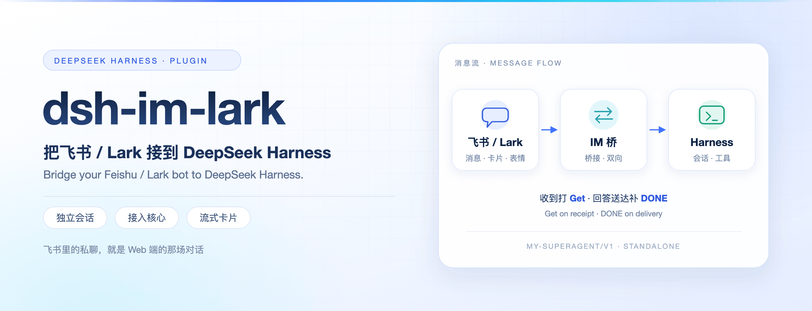

# dsh-im-lark

**简体中文** · [English](README.en.md)



把飞书 / Lark 机器人接到 DeepSeek Harness：在飞书里私聊机器人，等于在 Web 端对话。

两条互相独立的使用路径：

| 模式 | 开关 | 需要核心 | 行为 |
| --- | --- | --- | --- |
| **独立会话**（默认） | 接入飞书，关闭「接入我的超级助理」 | 否 | 插件自己建一个会话，直接在飞书里聊；文字命令、问题与审批提醒由插件处理 |
| **接入核心** | 接入飞书 + 接入我的超级助理 | 是 | 飞书当作 Web 端的一个入口：消息、命令、提醒整体交给核心 |

两种模式互斥：只有「接入我的超级助理」打开且核心服务在时才走核心，否则一律独立会话，
同一句话不会被两处处理。面板上的核心开关在没装核心时是禁用的。

## 能力

- **入站**：文本、富文本、图片、文件；语音/视频/表情包等给一句明确提示，不静默丢弃
- **出站**：Markdown 卡片、图片；长回答按字符与卡片体积双上限切段
- **引用回复**：回答引用触发它的那条消息，单聊与群里都成立
- **处理反馈**：收到消息先打 `Get`（收到）表情，**回答真正送达后**才在原消息追加 `DONE`，两个标记并排保留——入队不算完成（核心把消息入队后任务才异步跑）；核心模式按核心的 `completes` 完成标记打（停滞、派发回执、转投确认等都不带；取消、失败、审批被拒、超出 token 上限而中断的回合也不带，因为它们没有正常答复；旧核心不打），独立模式按回合对齐，提醒作答在**结算**后当场打（多题只答一半时提醒还在等，不盖 `DONE`）；失败只保留 `Get`，不留「已完成」的假信号；同一消息只补一次。飞书没有官方「正在输入」接口
- **卡片更新**：流式回答原地更新同一张卡片；超过平台限制（14 天、单卡 5 QPS）后改发新卡
- **交互卡片**：核心模式的**单问题**单选题与多选题在飞书里勾选后提交，结果交回核心；
  独立模式的单题提问同样发卡片（单选/多选都是勾选器，靠文案区分，必须点提交），其余仍走
  文字提醒。多问题与审批只发提示，请在 Web 端作答（核心要求一次提交全部问题，卡片回调
  做不到分题提交）；两者都支持「其他」输入
- **群聊**：只响应 @机器人 的消息（群聊权限只申请 @ 系列），不读全群
- **任务提醒**：独立模式下，回合跑得久（默认超过 30 分钟）会在结束时发一条带耗时与结论的提醒；回合失败或被外部中止时立刻提醒并带上原始错误。主人自己按的停止不算失败
- **面板**：Web 端插件页扫码一键创建应用，或手动填 App ID / App Secret；看连接状态、开关收发/核心接入、改消息行为；独立模式可调回合内插话、会话工作区、问题/审批提醒与长程任务提醒

> 提问卡片（勾选器 + 提交 + 「其他」输入）在独立模式与核心模式都已于真实飞书租户验收：
> 单选/多选靠卡片文案区分，提交后回传勾选项与「其他」输入。两种模式的作答被拒都有可见
> 反馈：还能答的卡会**整卡重画**并写上原因（飞书的表单提交是一次性的，只发一句提示
> 会让卡片点不动），可以重新勾选提交；已经不能再答的卡直接改成失效态、去掉勾选框。
> `Get` / `DONE` 表情与卡片排版随租户配置略有差异，以实际表现为准。

## 安装

正式版进 `latest`，预发布进频道标签（`stage` / `rc`），两者不会互相覆盖：

```bash
# 正式版
dsh plugin --profile web add dsh-im-lark

# 预发布
dsh plugin --profile web add dsh-im-lark@stage
```

从源码装（开发用）：

```bash
npm install
npm run build
dsh plugin --profile web add file:/绝对路径/dsh-im-lark
```

`file:` 依赖是**注入副本**，装进 profile 的 `node_modules` 后与仓库解耦：改了代码要
`npm run build`，再卸了重装才会同步到运行中的 Host。

```bash
dsh plugin --profile web remove dsh-im-lark
dsh plugin --profile web add file:/绝对路径/dsh-im-lark
```

重装后不用重启 `dsh web`：Host 半由热重载接管，浏览器刷新页面即可。打开
**设置 → 飞书机器人**（或 **插件 → dsh-im-lark**）填写凭据。

### 扫码创建应用

面板的「应用凭据」里点「扫码创建应用」，用飞书扫描二维码并在手机上确认。应用创建成功后凭据会自动保存并开始连接；二维码 1 小时内有效、仅限一位用户使用。

创建出来的应用仍要确认权限与事件订阅（见下一节）。如果长连接一直收不到消息，先检查「事件订阅」是否为**长连接**、是否订阅了 `im.message.receive_v1`。

## 飞书侧准备

1. 在[飞书开放平台](https://open.feishu.cn/app)创建**企业自建应用**，拿到 App ID 与 App Secret。
2. **添加应用能力 → 机器人**。
3. **权限管理**开通：
   - `im:message.p2p_msg:readonly`（接收单聊消息）
   - `im:message.group_at_msg:readonly`（接收群里 @机器人 的消息）
   - `im:message:send_as_bot`（以机器人身份发消息）
   - `im:resource`（上传/下载图片与文件）
   - 表情回应（可选）：控制台里与 reaction 相关的权限。没有也不影响主流程，
     「正在处理」提示会自动降级为不发
4. **事件与回调**：
   - 「事件订阅」选择**长连接**，订阅 `im.message.receive_v1`；
   - 「回调配置」添加 `card.action.trigger`（需要卡片交互时），同样走长连接
5. **发布版本**并等管理员审核通过；未发布前只有开发者自己能用。

> 长连接模式不需要公网地址、不需要配置请求网址。每个应用最多 50 条长连接，多实例部署时**只有一条**连接会收到事件，所以不要靠多开进程做水平扩展。

## 配置

静态配置写在 profile 的 patch 里，改完重启生效：

```yaml
- id: dsh-im-lark
  name: dsh-im-lark
  config:
    domain: feishu          # feishu（默认）或 lark（国际版）
    maxText: 2000           # 单条消息字符上限，超出自动切段
    typingIndicator: true   # 收到打 Get；回答送达后原消息追加 DONE（Get 不撤）
    replyStatus: false      # 回答末尾附加模型、耗时、token
    directBusyMode: steer   # 独立会话里回合进行中又来消息：steer 插话 / queue 排队（旧值 interrupt 会迁移成 steer）
    directWorkspaceId: ''   # 独立会话的工作区 id；留空用自动创建的默认工作区
    questionReminders: true # 独立模式下有问题/授权在等时发飞书提醒
    questionDelayMinutes: 5 # 提醒前等多久（0–120）：这段时间在 Web 端答完就不打扰
    longTaskReminders: true # 独立模式：回合耗时超过阈值时发完成提醒
    longTaskMinutes: 30     # 长任务阈值（1–1440 分钟）
    failureReminders: true  # 独立模式：回合失败或被外部中止时立刻提醒
```

面板能改的项会落到 `$DSH_HOME/.dsh-im-lark/config.json`，卸载重装后沿用。凭据单独存 `credentials.json`，目录 0700、文件 0600，日志与错误信息里只出现 App ID 尾号；面板显示完整 App ID 与绑定时间，Secret 不回显。

## 独立会话命令

| 命令 | 作用 |
| --- | --- |
| `/help` | 命令列表 |
| `/new` | 开新会话 |
| `/sessions` | 列出最近会话，切到指定会话 |
| `/status` | 当前会话与运行状态 |
| `/stop` | 中止正在跑的回合 |
| `/trace` | 查看上一条回答的模型与耗时 |
| `/send <文本>` | 不经模型，直接发一段文本 |

## 命令行与斜杠命令

- **`/lark`**（Web 输入框）：`/lark <正文>` 把一段文字发到自己的飞书；`/lark status`
  看凭据与收件人是否就绪。不经模型。
- **`dsh-lark-send`**（终端 / 脚本）：`dsh-lark-send text <正文>`、`status`、`help`。
  收件人恒为主人，没有 `--to`；退出码 `0` 成功、`1` 发送失败、`2` 参数写错。

收件人恒为「主人」：独立模式是第一个在飞书里私聊机器人的人，核心模式是核心绑定的用户；还没有主人时会明确报错。

## 范围说明

- 独立模式：问题与工具授权在等主人时，插件发飞书提醒（延迟可调）：单题有选项的直接
  点卡片作答，多题/审批/自由输入仍用文字（回序号或选项文字）。长任务完成提醒仍由核心负责。
- 独立模式收到文件只给一句提示，不把文件内容送进会话；图片会作为输入附上。
- 核心模式的 `DONE` 要先把握手的入站 `messageId` 翻成平台消息 id，这张表只留最近 500 条
  （有界，防常驻内存增长）：插件重启后，或一条消息在 500 条之后才被核心报完成，
  就翻不到平台 id、不打 `DONE`——只影响完成表情，不影响答案送达。
- IM 卡片只承载单问题、有选项的交互；多问题/审批/自由输入交回 Web 端，避免出现
  「点了按钮但永远答不完」的卡。

## 限制（平台决定，不是实现取舍）

- 事件处理必须 **3 秒内** 返回，重活一律异步做
- 文本消息体 ≤ 150 KB，卡片 ≤ 30 KB，超了平台直接拒收
- 发消息 5 QPS（按用户 / 按群），插件内置限速与退避
- 同一张卡片可 PATCH 14 天、单卡 5 QPS；超时后改为新发消息
- 图片 ≤ 10 MB，文件 ≤ 30 MB，上传前本地先拦一道
- 编辑消息有次数上限，撤回窗口由管理员配置（常见 24 小时）
- 没有官方「正在输入」接口，只能用作表情作为弱提示

## 开发

```bash
npm run typecheck   # 类型检查（测试文件一起查）
npm test            # 单元测试
npm run build       # tsc 编译 host + esbuild 打 client 单文件
npm run verify      # 校验产物、依赖白名单、patch 只增不删
npm run check       # 上面四步全跑
```

目录：

```
index.ts             入口，转出 src/host/index.ts
src/host/            宿主侧：连接、入站、出站、卡片、桥接、独立会话、面板 RPC
src/client/          Web 面板（React，打成单文件 lib/client.js）
src/shared/          两侧共用的常量与版本
locale/              面板文案
docs/design/         方案设计
docs/protocol/       飞书开放平台事实（含来源链接）
docs/adr/            架构决策记录
```

改代码前读 `AGENTS.md`（文件规模、日志脱敏、不引新依赖等硬规则）。

### 门禁与发布

`npm run check` 是本地全量门禁，测试自包含：不依赖私有核心 `dsh-my-superagent`，
公开 CI 跑的就是同一套。

发布由 `.github/workflows/release.yml` 在 main 上完成（[ADR-0007](docs/adr/0007-发布流程与版本通道.md)）：
版本号三处同步（`package.json`、锁文件、`src/shared/version.ts`），正式版正文写
`docs/releases/v<版本>.md`；预发布不进 `docs/releases/`，Release 正文由 workflow 生成。
推 main 后自动打 tag、发 npm、建 Release：预发布只进 npm 的频道标签（`stage` / `rc`），
`latest` 只给正式版。

## 许可

MIT
