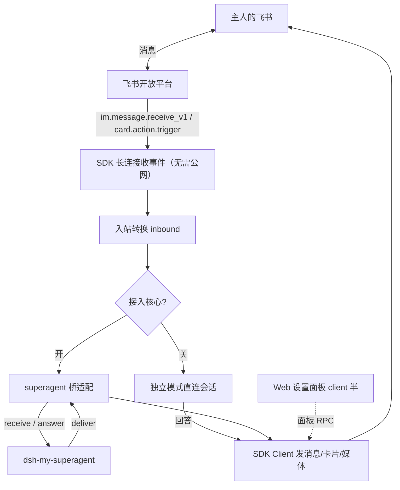

# 方案设计：dsh-im-lark（飞书 IM 桥）

状态：**已实施**（2026-11-19）。调研日期 2026-11-19；实现与本文不一致处见 `docs/adr/` 与文末记录。
外部事实见 [../protocol/00-飞书开放平台事实.md](../protocol/00-飞书开放平台事实.md)，本文只写「我们要做什么、怎么分、边界在哪」。

## 1. 背景与目标

把飞书（Lark）接入 DeepSeek Harness：主人在飞书里收发消息、作答、驱动会话；插件同时可作为 `dsh-my-superagent` 的 IM 桥（协议 `my-superagent/v1`）。

- **用户问题**：主人不在 Web 端时，会话提问、审批提醒、任务结果送不到手边；已有微信桥覆盖微信，飞书侧（工作沟通主阵地）没有对应通道。
- **预期结果**：装一个插件、在面板填好自建应用凭据，即可在飞书单聊/群聊里与 DSH 对话；装了核心并打开开关后，消息、命令、提醒整体交给核心。
- **验收标准（可观测）**：
  1. 面板填 App ID/Secret、开关打开后，飞书里给机器人发文字能进 DSH 会话并收到回复；
  2. 图片与文件入站、Markdown 出站、引用回复回指、交互卡点选/文字作答可用；
  3. 接入核心后 `/pair` 配对成功，核心交付送达飞书，回执与引用语义符合协议；
  4. `npm run check`（typecheck + test + verify）全绿，含核心导出的桥一致性测试。

## 2. 范围（一期）

| 做 | 不做（非目标） |
| --- | --- |
| 长连接收消息（单聊 + 群聊 @机器人） | Webhook 回调模式（需公网，不选） |
| 出站：文本 / Markdown 卡片 / 图片 / 文件，分条 | 语音、视频、表情包出入站 |
| 入站：text、post、image、file；其余类型文本化提示 | 合并转发、话题（thread）深度支持 |
| 交互卡（卡片 JSON 2.0 按钮 + 文字作答兜底） | 卡片模板（cardkit 搭建工具）体系 |
| 引用回复（`parent_id` → `replyTo`）、消息编辑/撤回 | 话题内 `reply_in_thread` 深度适配 |
| 处理状态（收到打 `Get`、回答送达后原消息追加 `DONE`，均不撤，best-effort，可关） | 消息已读回执、加急、Pin |
| Web 设置面板（两半式） | 扫码/设备码自动创建应用（只做手动填凭据） |
| 独立模式：直连会话 + 文字命令 + 问题/审批提醒 | 多机器人（多 App）并行管理、长任务完成提醒 |
| 接入 `dsh-my-superagent`（桥注册、能力声明） | 商店应用、外部群/对外共享 |

## 3. 两种模式（与既有 IM 桥同构）

| 能力 | 独立安装（不装核心） | 接入我的超级助理 |
| --- | --- | --- |
| 连接凭据、开关、状态面板 | 支持 | 支持 |
| 飞书发文字 → DSH 会话 | 支持（面板选工作区，默认自动创建「飞书会话」；首条建会话并复用） | 支持（核心前台会话） |
| 回合在跑时再发一条 | 面板选插话（`steer`）或排队（`queue`），对普通消息与 `/send` 生效；`/queue` 固定排队 | 核心 `front.submitMode` 决定 |
| 命令解析、主人判定 | 插件自己做（第一个私聊用户认作主人、固定命令清单） | 核心做 |
| 问题/审批提醒 | 插件发提醒（单题选项用卡片，其余文本），与 Web 竞答（[ADR-0005](../adr/0005-独立模式问题与审批提醒.md)） | 核心发卡片（插件只负责通道） |
| 长程任务完成 / 失败任务提醒 | 插件自己跟踪回合，发文本提醒（[ADR-0006](../adr/0006-长程任务与失败任务提醒.md)） | 核心发 |
| 交互作答 | 不支持（没有核心就没有可作答的卡片） | 经核心 `answer` |
| 图片/文件入站 | 只收主人的，交直连会话 | 核心声明 `owner-images`/`owner-files` 且 `owner-lookup` 判定后上报 |

两种模式**互斥共存**：判据 `ownFeatures = 启用 && 未接入核心 && 已连接 && 未停机`；「接入核心」= 面板开关开 **且** `mySuperagent` 服务在。核心没装时开关禁用（打不开），接入核心后独立模式设置在面板锁住。

## 4. 总体架构

两半式 DSH 插件：host 半跑在 DSH Host 进程内（协议、长连接、会话直连、桥适配），client 半是 Web 设置面板（esbuild 打成单文件）。

依赖方向：`lark/`（协议客户端） ← `superagent/` 与 `direct/`（领域） ← `runtime`（装配）。`lark/` 不感知超级助理，`superagent/` 不感知传输细节，两者在装配层接线。

## 5. 能力地图（模块与构建顺序）

| 模块 id | 职责 | 依赖 |
| --- | --- | --- |
| `scaffold` | 包骨架：package.json、tsconfig、build/verify 脚本、cordis.patch、入口、AGENTS/README 骨架 | — |
| `lark-client` | 长连接与 API 封装：WSClient 装配、事件分发、token、发送/回复/编辑/撤回、媒体上传下载、频控与错误分类、活性检测 | `scaffold` |
| `inbound` | 事件 → 统一入站草稿：去重（message_id）、@ 剥离、text/post 解析、图片/文件下载准入、引用 id 提取 | `lark-client` |
| `outbound` | 交付 → 平台消息：Markdown 卡片渲染、分条、图片/文件出站、幂等与回执、卡片原地更新 | `lark-client` |
| `cards` | 交互卡：问题/选项成卡、`card.action.trigger` 作答回传、文字作答兜底、卡终态改写 | `outbound` |
| `panel-host` | 面板 RPC：状态、连接开关、凭据落盘、独立模式/提醒设置、工作区列表、契约版本 | `scaffold` |
| `bridge` | `my-superagent/v1` 适配：能力声明、deliver/receive/answer、健康状态、延后注册 binder | `inbound` `outbound` `cards` |
| `standalone` | 独立模式：工作区绑定、直连会话提交、文字命令、状态行 | `inbound` `outbound` `cards` |
| `workspaces` | 默认工作区：宿主工作区服务的可选接入、自动创建与候选列表 | `scaffold` |
| `reminder` | 独立模式的问题/审批提醒：延迟竞答、文本作答、待答表与发送限速 | `standalone` `inbound` |
| `long-tasks` | 独立模式的长程任务与失败任务提醒：回合计时、成败判定、子代理过滤、文本渲染 | `standalone` |
| `panel-client` | Web 面板 UI：连接区、开关、插话/工作区/提醒/长程任务设置、状态与最近错误 | `panel-host` |
| `cli` | 出站入口：`/lark` 斜杠命令 + `dsh-lark-send` 命令行 | `outbound` |

构建顺序：`scaffold → lark-client → inbound → outbound → cards → panel-host → bridge → standalone → workspaces → reminder → panel-client → cli`。
其中 `bridge` 与 `standalone` 都在 `inbound/outbound` 之上、彼此不依赖，可并行；`panel-client` 只依赖 `panel-host` 的 RPC 契约，可与后半程并行。

## 6. 关键设计决策

### 6.1 传输：长连接 + 官方 Node SDK（已确认）

- **目标**：本地开发与家用机都能收消息，不引入公网地址、内网穿透、验签解密。
- **依据**：长连接是唯一免公网路径，仅限企业自建应用；限制是 3 秒处理、50 连接、集群不广播（[事实 §1](../protocol/00-飞书开放平台事实.md)）。
- **代价**：引入一个运行时依赖 `@larksuiteoapi/node-sdk`（与既有 IM 桥的零依赖约定不同，本插件**刻意偏离**，理由是飞书 SDK 承担握手、鉴权、重连、OpenAPI 封装，自写成本与风险都更高）；SDK 版本钉死在 `1.76.0`，升级单独提交。
- **单活约束**：集群不广播 → 同一 App 只能有一个活跃连接。插件按「一个 profile 一个连接」实现，面板显示连接状态；不做多副本。
- **3 秒约束**：事件 handler 只做「校验 + 入队 + 立即返回」，重活（下载媒体、交核心）异步做；重复投递按 `message_id` 去重（不用 `event_id`）。
- **SDK 重连不完全可信**（社区报告心跳不校验 pong）：外层加**活性检测**——定时用 `Client` 发一次轻量探测（或维护「最近事件/发送成功时间」），连续失败把 `health` 调成 `down` 并重建 WSClient；重建有退避上限。

### 6.2 凭据与应用创建

- 只做**手动填写 App ID / App Secret**（面板输入，落 `$DSH_HOME/.dsh-im-lark/` 私密文件，`0600`，原子写）。不实现任何自动创建应用的私有流程。
- 面板给出**配置清单**（开启机器人能力、权限 scope、事件 `im.message.receive_v1` 长连接、回调 `card.action.trigger` 长连接、发布版本），照着点即可；连接自检：拉一次 `tenant_access_token` + `Client` 探测，把错误原文归类显示。
- 凭据不进日志；面板显示完整 App ID、绑定时间与「已设置」；Secret 不回显。

### 6.3 桥能力声明（`my-superagent/v1`）

| 能力 | 声明值 | 依据 |
| --- | --- | --- |
| `markdown` | `full` | 卡片 JSON 2.0 markdown 组件支持标准 Markdown 主体（代码块真机验证前，渲染层做降级兜底） |
| `maxText` | `{ max: 2000, unit: 'char' }` | 卡片请求体 ≤ 30 KB，按中文 3 字节/字保守取 ~6000 字内再留标签开销；超限由桥分条 |
| `interaction` | `choice/multiChoice/freeText: true`，`maxOptions: 20`，`maxQuestions: 10`，`updateAfterAnswer: 'any'` | 多题收进同一张 form 一次提交，题目数取协议上限 10；实际能否上卡还受 200 组件与卡片体积约束，超限降级为纯文本卡片 |
| `edit` | `{ scope: 'any', minIntervalMs: 2000, maxLifetimeMs: 14d }` | 卡片 PATCH：5 QPS 上限取 2 秒一次留余量；14 天平台硬限制 |
| `detail` | `true` | 卡片内折叠（collapsing panel）呈现 |
| `nativeCommands` | `false` | 飞书无平台原生命令登记口 |
| `quoteReply` | `true` | 事件带 `parent_id`/`root_id`，可读被引用消息 id |
| `quotas` | `[{ scope: 'conversation', max: 5, windowMs: 1000 }]` | 同用户 5 QPS、同群共享 5 QPS（业务级） |
| `outbound` | `{ requiresPriorInbound: false, images: true }` | 无「用户先开口」限制；图片上传 ≤10 MB 支持出站 |

- 分条：超过 `maxText` 按段切；`delivery.id` 幂等表在内存（进程重启重发一遍比漏发安全），重试从断点续发。
- **参考段裁剪**：交付卡正文末尾的「参考：- <会话标题>」来自 `refs`，只在消息**没有引用气泡**时渲染——真的走成了引用回复（`inReplyTo` 能在入站表里翻到平台消息 id）时省略，引用气泡已经定位到原消息。判据必须是「引用回复发送成功」而不是 `inReplyTo` 有值：入站表是内存映射，插件重启后一律翻不到（重启孤儿通知正是这种），那时消息没有引用气泡，「参考」是唯一的定位线索。卡片重画（作答终态、重试、过期替代）沿用首屏那份交付，不会把参考段补回来。
- `supersedes`：旧卡 PATCH 成终态（「已被新卡替代」），避免两张矛盾卡同时可作答。
- `expiresAt`：发送前再看一眼，过期不发。
- **真机验收（2026-11-27）**：单题与多题表单都已在真实租户跑通——多题共用一张 form 时按 ①②③ 排开、题干加粗，提交后 `form_value` 按 `answer_<题号>_<选项号>` / `custom_<题号>` 回传，核心一次拿到全部题目。

### 6.4 入站语义

- 去重键：`messageId = chat_id + message_id`（渠道内唯一），`platformMessageId = message_id`（引用回指用平台原 id，逐字不改）。
- 群聊：仅处理 @机器人 的消息（权限按 `group_at_msg` 申请，最小面）；@ 占位符 `@_user_1` 按 `mentions` 还原或剔除。
- 准入闸：图片/文件**只为主人下载**。核心声明 `owner-lookup` 时先问 `BridgeHandle.isOwner`，明确不是主人就只上报文字；独立模式按 `owner.json` 判定。下载有大小与超时上限，失败降级为纯文本说明。
- 文件上限按核心协议在桥侧先剔除（≤3 个、单个 8 MiB、合计 16 MiB），超限整条按协议会被拒，不能指望核心兜底。
- 非主人消息：不解析命令、不驱动会话（核心模式按协议上报为 `ignored`；独立模式只记审计）。

### 6.5 交互作答

- 问题/选项 → 卡片 JSON 2.0：**一个 form 容器装下全部题目**，一个「提交」按钮一次提交整张卡。表单控件 `name` 全卡唯一，按 `answer_<题号>_<选项号>`（勾选器）与 `custom_<题号>`（自由文本）命名，提交按钮的 `behaviors.value` 只带 `{ d }`；`card.action.trigger` 的 `form_value` 里带着全部控件的值。
- 核心要求一次提交**全部问题**的作答（`validateAnswer` 要求每题恰好一条），所以多题不能拆成多张表单分批提交，只能一张表单一次提交。能力声明 `maxQuestions: 10` 与协议上限一致；核心不会按它裁剪，桥自己守住。
- 少答某一题、或单选题勾了多项时整单退回：按题号提示并把卡片连同控件重画（表单提交是一次性的，提交过的卡不再触发回调，只发一句提示等于把卡废掉）。重画时用 `formValues` 回填已勾选与已填内容（勾选器 `checked`、输入框 `default_value`），用户只需改错的那一题。
- 单选题同时勾了选项又填了「其他」时，以「其他」为准（`selected: []` + `custom`）：单选只应有一个答案，两者都交会变成两项。多选题允许勾选与「其他」并存；已作答卡把两段都展示出来，不能只显示勾选项。
- 无选项的题用 `input` 收自由文本，核心的 `validateAnswer` 接受非空 `custom`；含审批的交互不登记为可作答，回调只回「审批请在 Web 端处理」。
- 题目多到装不下（200 组件或 28 KB）时不发交互卡，改为纯文本卡片并把题目、选项与回复格式一并发出，用户直接文字作答。
- 回调 3 秒约束：收到立即入队返回，卡片终态改写异步 PATCH。
- **文字作答兜底**（协议要求）：用户回「2」「1,3」或选项文字时由核心 `answerFromText` 匹配——桥只 `receive`，不自写解析。
- 审批类（`intent: 'approval'`）按协议只提醒、不在 IM 作答。
- **验收状态**：单题与多题表单都已在真实租户验收通过（多题：同一 form 多题 + `form_value` 键值），见 §6.3 的记录。

### 6.6 输入状态、编辑、撤回

- 输入状态：用户消息上加 `Get` reaction（收到）；`DONE` **只在回答真正送达后**追加到原消息——`receive` 返回 accepted 只代表消息入队（核心 emit 事件即返回、独立模式提交即返回），入队就打会给「已完成」的假信号。提醒作答只在**结算成功**时当场打（多题只答一半还在等，不打）。`Get` 不撤（失败时也保留，只表示「收到过」）；best-effort，失败静默，面板可关（[事实 §12](../protocol/00-飞书开放平台事实.md)：官方无 typing API 文档）。核心模式的完成判据是核心的 `Delivery.completes`（my-superagent#3，`owner-message-completion`）：只有正常收尾的回合才列（取消/失败/审批被拒/超出 token 上限而中断都不算），一条交付可完成多条消息；旧核心不发则不打（漏打优于误打），入站映射超出 500 条或重启后翻不到平台 id 时也不打。此前按 `intent`/`refs`/标题猜的启发式已删——会误打（派发恢复、转投确认）也会漏打（前台直接回答）。独立模式按 `DoneAlign` 对齐（queue 一轮一条、steer 同轮吸收多条，换会话清空）。
- 编辑：只用于**卡片**（PATCH 14 天 / 5 QPS / `update_multi:true`）；普通文本不承诺原地编辑。
- 撤回：仅用于插件自己发的、且属于「命令回执/错误提示」这类可回收消息；交付不撤回（撤回会让引用语义断裂）。

### 6.7 独立模式

- 工作区绑定、首条消息建会话复用、插话（`steer`）/排队（`queue`）（对普通消息与 `/send` 生效，`/queue` 固定排队）、回复状态行。工作区在面板里从宿主工作区服务选；没选时用插件自动创建的默认工作区（`$DSH_HOME/dsh-im-lark`），建不出来才退回宿主默认位置。
- 问题/审批提醒（2026-11-21 加入，见 [ADR-0005](../adr/0005-独立模式问题与审批提醒.md)）：监听宿主的 `user-questions/request` 与 `approval/request`，先把请求交给 Web 并等延迟窗口；到点发飞书提醒（单题有选项用交互卡片，其余文本），与 Web 竞答。审批只认明确「批准」，超时/停用交回 Web，不做默认拒绝。多机器人管理仍不在范围内。
- 长程任务与失败任务提醒（2026-11-21 加入，见 [ADR-0006](../adr/0006-长程任务与失败任务提醒.md)）：跟到 `turn/end`，正常结束且耗时超过阈值（默认 30 分钟）发完成提醒；失败或被外部中止时不看耗时立刻提醒并带平台原文。子代理会话、主人自己按的停止都不提醒；绑定的那个会话不发完成提醒（回答已经发过了），失败提醒照发。
- 文字命令清单（只认已认领的主人、不进模型）：`/help` `/new` `/sessions [页码]` `/switch <序号、0、front 或会话 id>` `/send <序号、0 或会话 id> <内容>` `/queue <序号、0 或会话 id> <内容>` `/trace` `/stop` `/status`。`/sessions` 每次列一份新快照（落盘），序号在下次列出前不变，**不包含前台会话**——前台固定为序号 `0`，避免切回前台后列表里再套一个自己；`/switch` 按快照换绑，`/switch 0` 与 `/switch front` 回到最初的前台会话（精确的前台 id 也认）；前台被删时 `/switch 0`/`/send 0` 提示 `/new`。切到非前台会话后，回复前加 `**会话名>**`（`switched` 落盘在 `direct.json`，`/new` 清除）；切回前台后前缀消失。目标会话还有投递在等回答时拒绝切换；换到其它会话（含回到前台）会清空待结算队列，切到当前会话不动队列。`/send` 与普通消息一样受「回合内插话」设置影响，`/queue` 固定排队；两者那一轮的回答都回到当前聊天。目标是当前绑定会话时走普通提交，`/send 0`/`/queue 0` 指向前台。`/trace` 仍是「上一条回答的模型与耗时」，与核心的跟踪语义不同（后续再对齐）。
- 状态目录 `$DSH_HOME/.dsh-im-lark/`（凭据、设置、主人与会话绑定、`/sessions` 序号快照），默认工作区 `$DSH_HOME/dsh-im-lark/`，两者分离。

### 6.8 出站入口

- 斜杠命令 `/lark`（人用，模型调不到）与 `dsh-lark-send`（模型/脚本用，bash 调用），收件人**恒为主人**，无 `--to`；退出码 `0/1/2` 语义与既有桥一致。

## 7. 工程约定（继承既有 IM 桥）

- TypeScript strict + `erasableSyntaxOnly`；相对 import 写 `.ts` 后缀；文件 ≤ ~500 行，超了先拆。
- 运行时依赖**只有** `@larksuiteoapi/node-sdk`（钉版本）；`peerDependencies` 只允许 `@deepseek-ai/*` 且标 `optional`。
- 宿主与核心服务用最小结构类型描述，**不 import 也不依赖宿主包与 `dsh-my-superagent` 包**（测试自包含，桥一致性契约在本地重写）。
- 外部输入（事件、回调、面板 RPC、配置文件）在边界按 Schema 校验；密钥/令牌不进日志与面板快照；子进程 argv 数组不经 shell。
- **文档、代码、注释、commit 一律不提任何其他飞书/Lark 插件仓库**；平台事实出处只写官方文档 URL。
- 提交：Conventional Commits + 中文标题，按功能/模块分次提交，只本地提交不推送（默认）。
- 关键决策写 ADR（`docs/adr/NNNN-标题.md`，四段式）；外部事实只进 `docs/protocol/`。

## 8. 测试与证据

- 单测（`node --test`，每测独立临时目录）：协议客户端（token、错误分类、频控退避）、入站解析（text/post/@/引用/去重）、出站渲染（分条、幂等、降级）、卡片作答映射、独立模式命令、面板 RPC 校验、配置与状态文件权限。
- 桥一致性：调用核心导出的 `runBridgeConformance`（devDependency，仅测试）。
- 构建门禁：`npm run check` = typecheck + test + verify（产物可由源码确定性重建、清单合规）。
- 真机验收清单（本地，不入库）：连接自检、单聊/群聊 @、图片文件出入站、卡片点选、引用回指、编辑/撤回、接入核心 `/pair` 全链路。
- 证据阶梯：E1 静态 → E2 单测/一致性 → E3 临时 profile 装载冒烟 → E4 真机（另行确认）。

## 9. 风险与开放问题

| 风险 | 应对 |
| --- | --- |
| SDK 心跳静默断链（社区报告） | 自建活性检测 + 退避重建；面板显示连接状态与最近错误 |
| 3 秒处理超时重推 | handler 只入队即返回；`message_id` 去重 |
| 集群不广播（多实例抢事件） | 单活设计；面板提示「同一 App 只能一处在线」 |
| 卡片代码块/表格真机表现不符 | 渲染层降级路径；验收清单实测后回填 `markdown` 能力值 |
| 频控 5 QPS（同用户/同群） | 出站令牌桶按会话计；撞 429 按 `x-ogw-ratelimit-reset` 退避，回执报 `rate-limited` |
| 权限/发布配置繁琐导致「连上了但收不到」 | 面板配置清单 + 连接自检把缺权限的错误原文归类提示 |
| `Get` / `DONE` 表情在个别租户不显示 | 已对照官方[表情文案说明](../protocol/00-飞书开放平台事实.md)确认为内置取值；仍按 best-effort 处理，失败静默，不行就关掉该项 |

**开放问题已决（2026-11-19 评审）**：
1. `maxText` = **2000 字符**（卡片 30 KB 边界留足余量，接受更频繁分条）；
2. 群聊**只响应 @机器人**（用 `im:message.group_at_msg` 最小权限面，不申请敏感的 `im:message.group_msg`，面板不加全量开关）；
3. 独立模式一期做直连会话 + 命令 + 状态行；提醒类功能由核心负责（V0.1 不在独立模式实现）。
   —— 2026-11-21 调整：问题/审批提醒改由独立模式接管（与 Web 竞答），理由与边界见
   [ADR-0005](../adr/0005-独立模式问题与审批提醒.md)；长程任务与失败任务提醒也一并由独立模式接管
   （[ADR-0006](../adr/0006-长程任务与失败任务提醒.md)）。
4. 桥一致性测试**自包含**：不引入 `dsh-my-superagent`，契约用例在本地重写（撤销 2026-11-19 的「引入为 devDependency」决定，理由见 [ADR-0007](../adr/0007-发布流程与版本通道.md)）。

## 10. 交付物与里程碑

1. M1 `scaffold` + `lark-client`：骨架可构建、长连接可收事件（单测覆盖 token/错误/退避）。
2. M2 `inbound` + `outbound`：文字双向通、分条与幂等、媒体出入站。
3. M3 `cards` + `bridge`：交互作答、能力声明、一致性测试通过。
4. M4 `panel-host` + `panel-client`：面板全流程可用。
5. M5 `standalone` + `cli`：独立模式（对话、命令、状态行）。
6. M6 文档收尾：README、ADR、真机验收清单、五轴评审。

## 10. 实施记录（2026-11-19）

- 里程碑 M1–M5 已落地：脚手架与构建校验、长连接与凭据、入站/出站、桥与交互卡、
  面板两半、独立模式与命令行。
- 面板槽位按当前宿主实现落在 `plugins.bundle.config`（不再使用 `settings.section`）；
  对应决策见 [ADR-0004](../adr/0004-面板契约.md)。V0.1 面板只做凭据、连接状态、
  模式开关与消息行为；工作区/模型选择仍走静态配置，未做下拉选择。
- 多选卡片的回传形态（`action.option` 是字符串、逗号串还是数组）尚未真机验证，
  三种都解析并优先用序号回传，见 `docs/protocol/00-飞书开放平台事实.md` §14。
- 独立模式没有配对流程：第一个私聊用户被认作主人，落盘在
  `$DSH_HOME/.dsh-im-lark/owner.json`；接入核心后主人判定仍归核心。核心确认主人后，
  桥把 open_id/最近会话镜像进同一份 `owner.json`（优先单聊），供 `/lark`、CLI 与
  重启后的主动交付使用。
- 核心的 `Delivery.recipient` 是主人的 sender/open_id，不是飞书会话 id：桥在入站时
  维护 sender → chat_id 的映射（有界），发送前翻译；未知收件人直接回失败，不盲发。
- 核心的 `Delivery.inReplyTo` 引用的是桥自己的 `messageId`（`chatId:messageId`）：
  桥在入站时记 `messageId → platformMessageId`，发送时再翻译成飞书 message_id。
- 桥的 `health()` 跟随长连接状态：断线报 `down`、重连报 `degraded`，避免核心在断线
  期间继续排队。
- 独立模式 V0.1 不实现问题/审批/长任务提醒；此前设计里的提醒设置已从配置、面板和
  README 移除，提醒只在核心模式下由核心作为普通交付发来。
  —— 该决定已被 2026-11-21 的 [ADR-0005](../adr/0005-独立模式问题与审批提醒.md) 取代：
  问题/审批提醒回到独立模式，长任务提醒仍由核心负责。
- 平台业务错误码在 `api.unwrap` 里先分类（230025→too-long、99xxx→auth 等），不能再
  落回可重试的 `other`。
- 流式回答的卡片超限时只发一次分条稿并结束该流的原地更新；否则每次修订都会触发
  一次 PATCH 失败与重发，形成消息瀑布。
- 多题收进同一张 form 一次提交；超组件/体积上限或含审批时不发交互卡，改纯文本卡片（带题目、选项与回复格式）。

## 11. 实施记录（2026-11-21）

- 独立模式补上问题/审批提醒（ADR-0005）：延迟窗口内 Web 答完就不打扰；飞书先答则
  abort 本地信号让 Web 卡片收起；审批只认明确「批准」，超时/停用交回 Web。
- 面板补上「回合内插话」（`steer`/`queue`）与会话工作区下拉；工作区候选来自宿主
  `workspaceRegistry`，默认工作区自动建在 `$DSH_HOME/dsh-im-lark`。
- 面板契约 1 → 2：快照新增 `directBusyMode`/`directWorkspaceId`/提醒设置与待答数量，
  新增 `workspaces.list` 端点；旧页面会提示重启。
